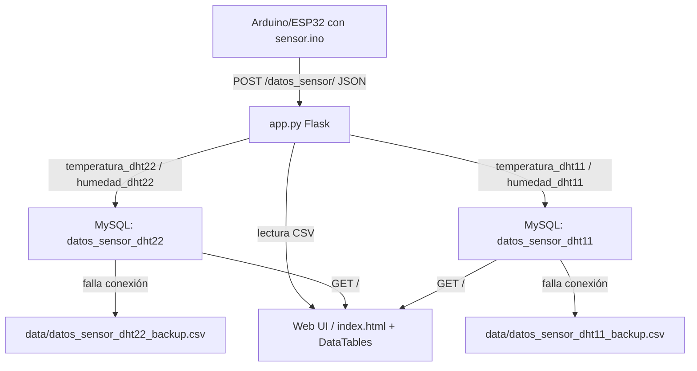

# weather-station

Sistema de monitoreo de temperatura y humedad. Recibe datos de sensores DHT22/DHT11 (via ESP32/Arduino por HTTP POST), los almacena en MySQL con respaldo a CSV y muestra un dashboard web.

[](LICENSE)
[](https://python.org)
[](https://flask.palletsprojects.com)
[](https://github.com/bi0punk/weather-station/actions/workflows/ci.yml)

## Contenido

- [Características](#características)
- [Arquitectura](#arquitectura)
- [Stack](#stack)
- [Estructura del repositorio](#estructura-del-repositorio)
- [Instalación](#instalación)
- [Uso](#uso)
- [Configuración](#configuración)
- [API](#api)
- [Base de datos](#base-de-datos)
- [Seguridad](#seguridad)
- [Tests / CI](#tests--ci)
- [Licencia](#licencia)

## Características

- Soporte dual de sensores (DHT22 exterior, DHT11 interior)
- Almacenamiento en MySQL con respaldo automático a CSV
- Dashboard web con DataTables (ordenamiento, búsqueda, paginación)
- Salida de consola con PrettyTable y colorama
- Firmware Arduino incluido (`sensor.ino`)
- Protección contra SQL injection via whitelist de nombres de tabla

## Arquitectura



## Stack

- Python 3 + Flask 3.0.3
- MySQL (mysql-connector-python)
- CSV (fallback por conexión fallida)
- PrettyTable + colorama + termcolor (salida de consola)
- Arduino (Ethernet + DallasTemperature + ArduinoJson)

## Estructura del repositorio

```
weather-station/
├── app.py                 # Servidor Flask (API + dashboard)
├── sensor.ino             # Firmware Arduino/Ethernet
├── templates/
│   └── index.html         # Dashboard con DataTables
├── static/
│   └── style.css
├── data/                  # CSVs de respaldo y fallback
│   └── .gitkeep
├── tests/
├── .github/workflows/
│   └── ci.yml
├── requirements.txt
├── .env.example
├── .gitignore
├── LICENSE
└── README.md
```

## Instalación

```bash
pip install -r requirements.txt
cp .env.example .env
# Edita .env con tus credenciales de MySQL
python app.py
```

Abre `http://localhost:8000` para ver el dashboard.

## Uso

El servidor escucha en `0.0.0.0:8000` (configurable con `FLASK_HOST`/`FLASK_PORT`) y recibe POSTs de los sensores en `/datos_sensor/`. El firmware `sensor.ino` está escrito para Ethernet Shield y POST a `/sensor` (una única temperatura).

## Configuración

Crea `.env` desde `.env.example`:

| Variable | Default | Descripción |
|---|---|---|
| `MYSQL_HOST` | `localhost` | Host del servidor MySQL |
| `MYSQL_DB` | `sensor_esp` | Nombre de la base de datos |
| `MYSQL_USER` | `dba_user` | Usuario de la base de datos |
| `MYSQL_PASSWORD` | — | Contraseña del usuario |
| `FLASK_HOST` | `0.0.0.0` | Host de escucha de Flask |
| `FLASK_PORT` | `8000` | Puerto de Flask |

Si `MYSQL_PASSWORD` no está definida arranca con un warning (conexión sin contraseña, solo para desarrollo).

## API

| Método | Endpoint        | Descripción |
|--------|-----------------|-------------|
| `POST` | `/datos_sensor/`| Recibe JSON de sensores (DHT22 + DHT11) |
| `GET`  | `/`             | Dashboard web con los datos |

El JSON de `/datos_sensor/` espera las claves `temperatura_dht22`, `humedad_dht22`, `temperatura_dht11` y `humedad_dht11`. Devuelve `400` si faltan claves.

## Base de datos

```sql
CREATE DATABASE sensor_esp;
CREATE TABLE datos_sensor_dht22 (id INT AUTO_INCREMENT PRIMARY KEY, fecha DATETIME, temperatura FLOAT, humedad FLOAT);
CREATE TABLE datos_sensor_dht11 (id INT AUTO_INCREMENT PRIMARY KEY, fecha DATETIME, temperatura FLOAT, humedad FLOAT);
```

Solo las tablas `datos_sensor_dht22` y `datos_sensor_dht11` están permitidas (whitelist).

## Seguridad

- **Debug mode:** desactivado por defecto en `app.py` (`debug=False`)
- **SQL injection:** los nombres de tabla se validan contra una allowlist
- **Credenciales MySQL:** se leen de variables de entorno, no están hardcodeadas

## Tests / CI

GitHub Actions (`.github/workflows/ci.yml`) ejecuta `ruff check` y `pytest` en push/PR a `main`/`master`.

## Licencia

MIT